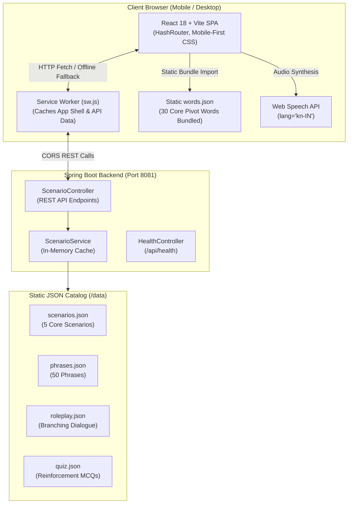
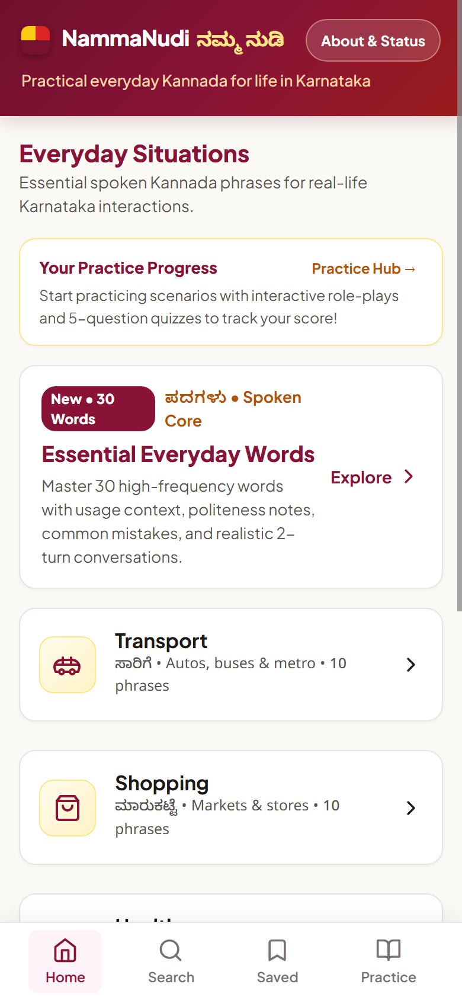
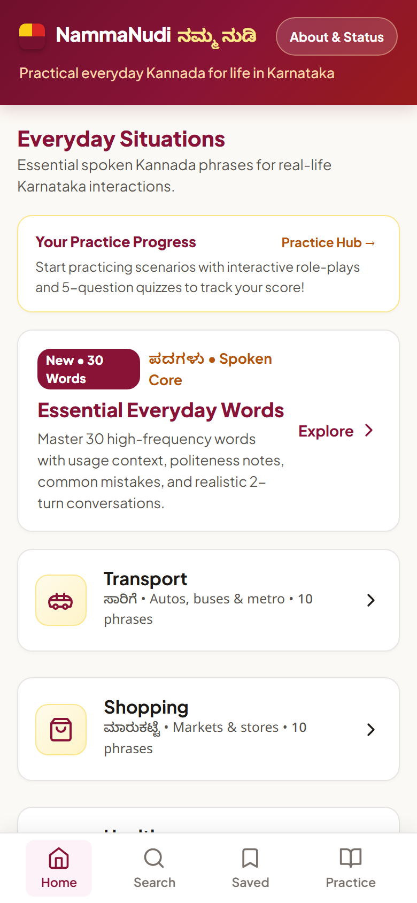
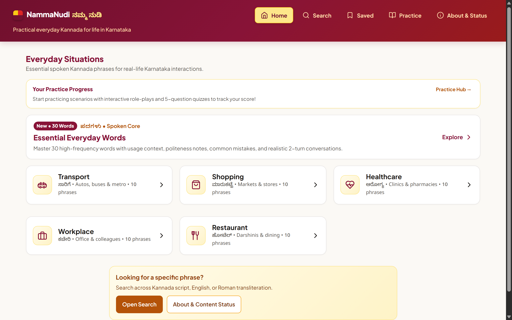

# NammaNudi (ನಮ್ಮ ನುಡಿ) — Everyday Spoken Kannada Assistant

[](https://namma-nudi.vercel.app)
[](#)
[](https://spring.io)
[](https://react.dev)

> **Live Deployment:** [https://namma-nudi.vercel.app](https://namma-nudi.vercel.app)  
> **No login required** — completely free, open, and private. Works immediately in your browser on mobile, tablet, and desktop.

Built for the **Kannada Digital Innovation Hackathon 2026** under **Problem Statement 03: Spoken Kannada in Everyday Life**.

---

## Problem Statement 03: Spoken Kannada in Everyday Life

Every year, thousands of students, tech professionals, and families relocate to Karnataka (Bengaluru, Mysuru, Hubballi-Dharwad, Mangaluru). While formal Kannada learning resources focus on classical literature or written grammar, newcomers face immediate practical hurdles in daily life:
- Hailing an auto-rickshaw and negotiating metered fares without friction.
- Asking for vegetables, milk, or groceries in neighbourhood *angadis* (stores).
- Conveying symptoms and dosages at local pharmacies and clinics.
- Engaging politely with office security, canteen staff, and house helps.
- Ordering breakfast and filter coffee at local *darshinis*.

**NammaNudi** bridges this gap by focusing strictly on **spoken, colloquial, everyday Kannada**. Every phrase provides:
1. Clear **Kannada script** (`ಕನ್ನಡ ಲಿಪಿ`).
2. Standardized **English phonetic transliteration** (e.g. *Ondhu cup coffee kodi*).
3. Plain **English meaning**.
4. **Cultural and politeness context** (respectful vs. informal registers, tips on polite suffixes like `-ri`).
5. **Interactive audio pronunciation** using the browser's built-in Web Speech API (`kn-IN`).

---

## Architecture

The system is designed with an offline-first, low-latency architecture:



---

## Core Features

- **5 Real-Life Scenarios (50 Phrases)**:
  - 🛺 **Transport (ಸಾರಿಗೆ)**: Autos, buses, metro, route directions, and fare negotiation.
  - 🛒 **Shopping (ಮಾರುಕಟ್ಟೆ)**: Markets, grocery stores, prices, quantities, and payment requests.
  - 🏥 **Healthcare (ಆರೋಗ್ಯ)**: Clinic visits, pharmacy interactions, symptoms, and dosages (*communication aids only, not medical advice*).
  - 💼 **Workplace (ಕಚೇರಿ)**: Office greetings, cafeteria chats, security and facilities staff communication.
  - ☕ **Restaurant (ಹೋಟೆಲ್)**: Darshinis, ordering food, water, bill requests, and dietary preferences.
- **Words Screen (30 Core Conversational Pivot Words)**:
  - Fast client-side debounced search over Kannada, transliteration, and English meanings.
  - Contextual filter chips for locations (`all`, `auto`, `darshini`, `market`, `street`, `general`).
  - Politeness guidance (formal vs. casual register and tips).
  - High-frequency collocations/pairings and authentic two-turn micro-dialogues.
  - Statically bundled into the app shell for **100% offline access**.
- **Interactive Role-Play Practice**:
  - Branching decision trees simulating real-world conversations with instant feedback.
- **Scenario Quizzes**:
  - Practice multiple-choice questions reinforcing vocabulary and scenario comprehension.
- **Favorites & Progress Tracking**:
  - Bookmark essential phrases for one-tap recall stored in browser local storage.
- **Responsive Layout**:
  - Tailored mobile-first layout with smooth transitions across mobile (360px–390px), tablet (640px–1024px), and desktop (1024px–1440px+).

---

## Screenshots

| Mobile View (390px) | Desktop View (1280px) |
|:---:|:---:|
| **Home & Scenarios**<br/> | **Home & Scenarios**<br/> |
| **Words Screen**<br/> | **Words Screen**<br/> |
| **Scenario & Phrases**<br/> | **Scenario & Phrases**<br/> |
| **Interactive Practice**<br/> | **About & Review Metrics**<br/> |

---

## Tech Stack

| Component | Technology | Details |
|---|---|---|
| **Frontend UI** | React 18, Vite | Mobile-first CSS, CSS variables, zero heavy UI frameworks |
| **Navigation** | Hash-based routing | Smooth SPA navigation compatible with static hosting |
| **Audio** | Web Speech API | Uses device native `kn-IN` voice synthesizer |
| **Offline Cache** | Service Worker (`sw.js`) | Caches shell and scenario API payloads |
| **Backend API** | Spring Boot 3, Java 21 | RESTful controllers, Maven build, H2/In-Memory cache |
| **Data Tooling** | Node.js scripts | `validate-v3.js`, `apply-review.js` for content review workflow |

---

## Content Integrity & Honest Review Metrics

We believe in complete transparency regarding language data accuracy:
- **0 / 50 phrases verified by native speaker (`reviewed=true`)**
- **50 / 50 phrases awaiting native-speaker review (`reviewed=false`)**
- Pronunciation audio uses the device browser's built-in `speechSynthesis` API (`kn-IN`). It is an automated synthesizer, not a native studio voice recording.
- Healthcare phrases are conversational communication aids for clinics and pharmacies, not medical advice.
- Review workflow is automated via `docs/review/v3_review_pack.csv` and `data/tools/apply-review.js`.

---

## Setup & Running Locally

### Prerequisites
- **Java 21+** and **Maven 3.9+**
- **Node.js 20+** and **npm 10+**

### 1. Environment Configuration
Copy `.env.example` to `.env` in the repository root:
```bash
cp .env.example .env
```

Default values in `.env.example`:
```env
SERVER_PORT=8081
APP_CORS_ALLOWED_ORIGINS=http://localhost:5173,http://localhost:4173
VITE_API_BASE_URL=http://localhost:8081
```

### 2. Start the Backend (Port 8081)
From `/backend`:
```powershell
mvn spring-boot:run
```
To verify backend health:
```powershell
curl http://localhost:8081/api/health
# Returns: {"status":"ok"}
```

Run backend unit tests:
```powershell
mvn test
```

### 3. Start the Frontend (Port 5173)
From `/frontend`:
```powershell
npm.cmd install
npm.cmd run dev
```
Open [http://localhost:5173](http://localhost:5173) in your browser.

To test the production build with Service Worker caching:
```powershell
npm.cmd run build
npm.cmd run preview -- --port 5173
```

### 4. Content Validation Suite
Run the automated schema and linguistic consistency validator:
```powershell
node data/tools/validate-v3.js
```

---

## License

Created for the **Kannada Digital Innovation Hackathon 2026**. Open source under the MIT License.
